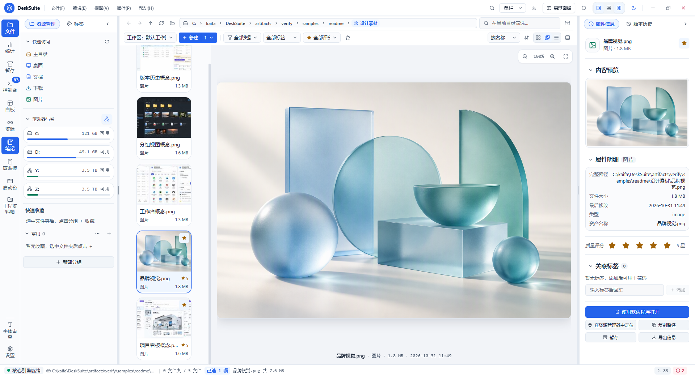
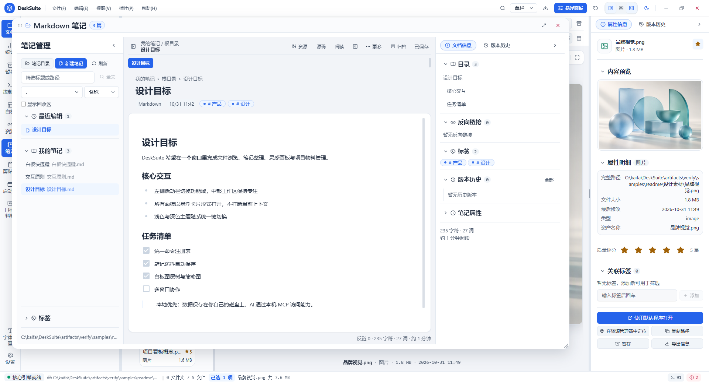
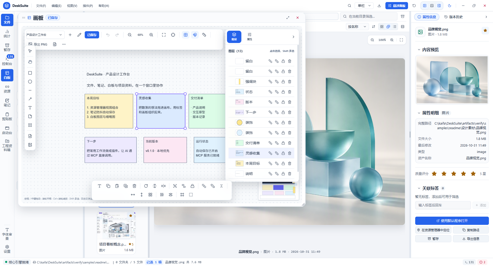
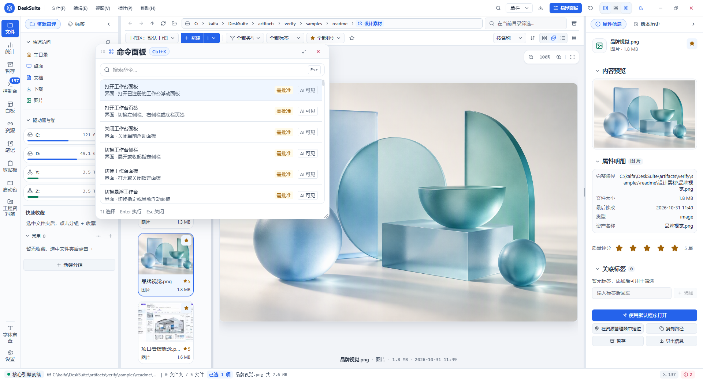

# DeskSuite

> 本地优先的桌面工作台：文件、笔记、白板与项目物料，在一个窗口里协作。

DeskSuite 是一个基于 **Electron + React** 的桌面工作台。它在同一个无边框窗口里整合资源管理、Markdown 笔记、无限画布白板和项目物料管理，并通过本机 **MCP 服务器**把全部能力开放给外部 AI —— 所有写操作都经过「计划 → 人工批准 → 执行 → 可撤销」的安全流程。

当前版本 `0.1.0`，Windows 优先，处于早期开发阶段。

## 界面

| 资源管理 | Markdown 笔记 |
| --- | --- |
|  |  |
| 目录树 / 画廊 / 预览 / 属性检查器，收藏、评分与标签 | 所见即所得 Markdown、frontmatter、目录、反链与版本历史 |

| 白板 | 命令面板 |
| --- | --- |
|  |  |
| LeaferJS 编辑器：图层树、吸附、裁剪与导出 | `Ctrl+K` 统一命令面板，标注「AI 可见 / 需批准」 |

> 截图均通过应用自身的 `capture_window` MCP 工具生成，未使用系统截屏。

## 功能

### 资源管理

- 实时读取磁盘目录，支持任意路径直接浏览，不依赖索引；大目录分页续读与虚拟滚动。
- 1 / 2 / 4 栏工作区，目录树、面包屑、多选、列表 / 画廊 / 分组视图。
- 收藏、评分、备注与层级标签，持久化在本地 SQLite；标签支持聚合视图。
- 系统缩略图（图片 / 视频 / PDF / Office）与磁盘 LRU 缓存，按需加载。
- 全局搜索与后台索引扫描（SQLite FTS5），索引缺失时浏览功能仍然完整可用。
- 目录监视：外部增删改在数秒内增量刷新，不触发整表重载。
- 快速收藏、暂存篮与网络驱动器管理。
- 文件写入统一走「计划 → 批准 → 执行 → 撤销」，支持复制、移动、重命名、新建与回收站。

### Markdown 笔记

- 基于 Milkdown Crepe 的所见即所得编辑器，保留 YAML frontmatter。
- 防抖自动保存、草稿恢复、新建笔记防覆盖与保存批准。
- 目录树、最近编辑、标签、反向链接、阅读 / 源码模式、查找替换。
- 图片与附件以「统一资源链接」引用本地原文件，不复制、不上传原始字节。
- 基于 Lore 的版本历史与快照，可查看、恢复与分支。

### 白板

- 基于 LeaferJS 2.x 的无限画布：矩形、椭圆、线条、箭头、文本、便签、画框、图片、视频与文件。
- 官方编辑器能力：变换、编组、锁定、富文本、图层树、撤销 / 重做。
- 标尺、参考线、Easy Snap 对象吸附、设计视口 fit / zoom。
- 图片内置裁剪编辑器，裁剪与变换可精确撤销。
- 统一资源拖入、Eagle 素材联动、多画板隔离，PNG / JPEG 导出。

### 项目物料（WorkCrate）

- 项目与物料管理，与 VectorCraft 双向同步。
- 基础信息预置、快速创建、画板排序与多选导出（PNG / JPG / 多页 PDF）。
- 保存后自动刷新，桌面端与外部编辑保持同步。

### 效率工具

- **命令面板**（`Ctrl+K`）：统一命令注册表，每个已注册 MCP 工具自动出现在命令列表。
- **启动台**：扫描开始菜单与已安装应用，缓存图标与说明，支持按用途整理。
- **剪贴板历史**：文本 / 图片分类历史、收藏与清理。
- **控制中心**：查看并启停渲染层插件、运行环境与 MCP 工具清单。
- **调试控制台**：运行时日志、级别筛选、搜索与载荷展开。
- **自动更新**：GitHub Releases 检查、下载与用户确认安装。

### AI 与 MCP

应用内置一个本机 MCP 服务器（Streamable HTTP，无状态），外部 AI 可直接调用所有插件能力，无需额外桥接程序。

- 仅监听 `127.0.0.1:9600/mcp`，端口可在 `config.json` 的 `mcp.port` 修改。
- 访问级别 `off` / `read` / `standard` / `full`，由注册表统一判定，插件不能自行放行。
- 写操作必须生成计划并由用户批准；可写范围由 `mcp.writeRoots` 限定。
- 覆盖文件读写、搜索、标注、笔记、白板、项目管理、剪贴板、启动台、命令、窗口截图等能力。

## 技术栈

| 层 | 选型 |
| --- | --- |
| 桌面运行时 | Electron 40 + electron-vite 6 / Vite 8 |
| 界面 | React 19 + TypeScript 5.7 + Tailwind CSS 4 + lucide-react + cmdk |
| 插件容器 | Cordis 4（主进程为唯一插件运行时） |
| 画布 | LeaferJS 2.3.2 + editor / export / viewport / view / arrow / text-editor |
| 画布扩展 | leafer-x-ruler、clip-resize-inner-editor、easy-snap |
| 笔记 | Milkdown Crepe / Kit 7.23.0 |
| 本地数据 | `node:sqlite`（WAL + FTS5）、原子 JSON 文档、chokidar |
| AI 接口 | `@modelcontextprotocol/sdk` + zod |
| 打包与更新 | electron-builder 26 + electron-updater |

## 快速开始

环境要求：**Windows 10/11**、**Node.js 22+**。

```bash
git clone https://github.com/sinnyun/DeskSuite.git
cd DeskSuite
npm install
npm run dev
```

Windows 下也可以直接双击 `start-dev.bat` 启动开发模式。

### 常用命令

| 命令 | 说明 |
| --- | --- |
| `npm run dev` | 开发模式（热重载） |
| `npx electron-vite build` | 只构建主进程 / preload / 渲染层，日常验证用这个 |
| `npm run build` | 完整构建，会编译 Rust 版 lore-bridge（需要 Rust 工具链） |
| `npm run package:win` | 生成 Windows NSIS 安装包 |
| `npm run guard` | 架构守护检查 |
| `npm run typecheck` | TypeScript 类型检查 |
| `npm run verify:smoke` | MCP 工具列表与基础调用冒烟 |
| `npm run verify:shot` | 通过 `capture_window` 截取窗口到 `artifacts/verify/` |
| `npm run verify:stop` | 停止验证实例 |

> `native/lore-bridge/bin/desksuite-lore-bridge.exe` 由 GitHub Actions 编译维护。本地执行 `npm run build` 会覆盖该文件，构建后请用 `git restore native/lore-bridge/bin/desksuite-lore-bridge.exe` 还原，不要提交或推送本地二进制。

## 架构

```
┌──────────────────────────── 渲染进程 ────────────────────────────┐
│  workbench 宿主：容器 / 槽位 / 布局 / 主题 / 日志 / 服务注册表 / SDK │
│  src/renderer/src/plugins/*：外壳、UI 原语、资源、笔记、白板、项目…  │
└───────────────┬──────────────────────────────────────────────────┘
                │ window.bridge.invoke / onEvent（唯一桥）
┌───────────────▼────────── src/preload/index.ts ─────────────────┐
│  bridge：只暴露 invoke / onEvent 两个入口                        │
└───────────────┬──────────────────────────────────────────────────┘
┌───────────────▼──────────────── 主进程 ──────────────────────────┐
│  Cordis 容器 + 内置服务 config / ipc / mcp / window / store / jobs │
│  src/main/plugins/*：文件、索引、标注、画布存储、笔记、项目…        │
│  MCP Streamable HTTP → 127.0.0.1:9600/mcp                        │
└──────────────────────────────────────────────────────────────────┘
```

主进程是唯一的插件运行时，渲染进程只负责界面；所有可见界面（外壳、侧栏、工作区、悬浮面板、UI 原语）都来自渲染层插件，宿主 `workbench/` 只保留容器职责。

核心约束：

- 插件全自动发现：主进程 `import.meta.glob('./plugins/*/index.ts')`，渲染层 `import.meta.glob('../plugins/*/index.tsx')`。
- 插件命名 `<域>-<子类>-<名称>`，每个插件一个文件夹，必须附带 `PORTS.md` + `PORTS_ZH.md`。
- 禁止插件之间互相 import；跨插件协作只允许服务注入（主进程）或渲染层服务（`getService` / `useSyncExternalStore`）。
- 文件写入、SQLite 连接、JSON 文档、长任务、MCP 权限各自只有一个实现入口。
- `npm run guard` 强制检查上述边界，`npm run typecheck` 保证类型一致。

### 目录结构

```
src/main/
  app.ts                 创建根 Context，按序启动内置服务并聚合插件
  services/              内置服务：config / ipc / mcp / window / store / jobs / paths
  plugins/               主进程能力插件（文件、索引、标注、画布、笔记、项目…）
src/preload/index.ts     唯一桥 window.bridge（invoke / onEvent）
src/renderer/src/
  workbench/             宿主：容器、槽位、布局、主题、日志、服务注册表、SDK
  plugins/               渲染层插件：外壳、UI 原语与全部界面
native/lore-bridge/      Lore 版本桥（Rust，二进制由 CI 编译）
scripts/verify/          基于 MCP / CDP 的实机验证脚本
docs/                    验证、架构、路线图与设计文档
```

## 数据与安全

- **本地优先**：配置、SQLite、版本快照与缓存都保存在 Electron `userData`（Windows 下为 `%APPDATA%/DeskSuite`），用户文件留在原位置。
- **文件写入可撤销**：所有写操作先生成计划，经用户批准后执行，并记录审计日志；失败或冲突按项返回结果。
- **资源不复制**：笔记与白板只保存本地原文件的永久资源链接，不保存原始字节副本。
- **MCP 权限在基座强制**：插件声明工具的可变性与影响范围，由 `services/mcp.ts` 统一拒绝越权调用。
- **验证实例隔离**：开发 / 验收使用独立 profile 与 `full` 权限，可写根限定在 `artifacts/verify/samples`；发行版默认权限不受影响。

## 实机验证

项目要求每个开发阶段都通过应用自身的 MCP 完成实机验收，而不是只依赖静态检查。

```bash
# 1. 构建 Electron 产物（不会触发 Rust 编译）
npx electron-vite build

# 2. 启动隔离的验证实例（开发/验收使用 full 权限）
node scripts/verify/launch.mjs --profile artifacts/verify/profiles/dev --access full --write-root artifacts/verify/samples

# 3. 冒烟与功能验收
node scripts/verify/mcp.mjs smoke
node scripts/verify/capture.mjs

# 4. 停止实例
node scripts/verify/stop.mjs
```

界面断言优先通过 `evaluate.mjs` 只读检查 DOM / 几何；截图统一走 MCP `capture_window`；功能状态变更只通过 DeskSuite MCP 工具执行。完整脚本清单见 [docs/VERIFY.md](docs/VERIFY.md)。

## 文档

| 文档 | 内容 |
| --- | --- |
| [AGENTS.md](AGENTS.md) | 项目约定：架构、插件、MCP、验证与命令 |
| [docs/VERIFY.md](docs/VERIFY.md) | 实机验证脚本、MCP 验收流程与产物约定 |
| [docs/WORKBENCH.md](docs/WORKBENCH.md) | 工作台插件架构与跨层令牌契约 |
| [docs/ROADMAP.md](docs/ROADMAP.md) | 能力扩展路线图、数据所有权规则与进度台账 |
| [docs/LEAFERJS.md](docs/LEAFERJS.md) | LeaferJS 集成边界与资源生命周期 |
| [docs/NOTE_EDITOR.md](docs/NOTE_EDITOR.md) | 笔记插件实现状态、审查发现与约束 |
| [DESIGN.md](DESIGN.md) | 设计令牌：颜色、字体、明暗主题表面 |

## 状态

- `0.1.0`：F1–F5 能力批次已实现并完成统一实机回归，涵盖安全文件操作、标注与索引搜索、笔记、白板、项目物料、命令面板、启动台、剪贴板与自动更新。
- Windows 优先；打包资源与真实发布源仍需在目标机验证。
- 笔记双链、部分高级编辑交互与性能基准仍在推进，详见路线图与笔记文档。
